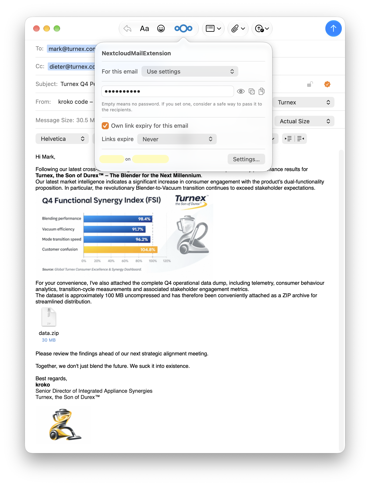

# Nextcloud Mail Extension (for Apple Mail)

NextcloudMailExtension is an extension for Apple Mail on macOS. When you send an email, its attachments are uploaded to Nextcloud server and replaced in the email by share links. Recipients download the files from your server, and your email stays small — no more bounces for oversized mail, no more dependence on Apple's Mail Drop or a provider's attachment limit.

## Index

## How it works

Attach files to an email in Mail as usual and hit Send. The extension uploads each file to a subfolder for that email in your Nextcloud, and puts links in their place:

- Each file gets a **view** link (opens the file in your Nextcloud) and a **download** link — or just a download link, if you prefer.
- With several files, the email can also get two links that open or download **all** the email's files at once, as one zip.
- Nothing is ever sent half-way: if an upload fails, the email is not sent, and you keep your files in the message window.

## Requirements

- A Mac with Apple silicon, running macOS 27 or later.
- A Nextcloud server, version 34 or later, reachable over HTTPS.
- You log in to Nextcloud through its own login page in your browser; the extension never sees or stores your Nextcloud password, and connects with an app password instead.
- In Apple Mail Sign is switched on.

## Installing

1. [Download](_placeholder-link-to-latest-release-dmg_) prebuilt App (signed and notarized) from releases.
2. Place the app into your `Applications` folder and start it once, to log in to your Nextcloud server and set your preferences.
3. In Mail, open **Settings → Extensions** and enable **NextcloudMailExtension**.
4. If Mail shows a **"Message security extension"** popup, choose NextcloudMailExtension there. (The extension takes over the Sign button in the message window: with Sign on, Mail hands the outgoing message to the extension, which is what makes the upload possible.)
5. Restart Mail.

One more thing to tick once: when Mail asks about **Mail Drop** for large emails (it will, before the extension gets its turn), choose **Try Sending in Email**, and tick **Don't ask again for this account**. The files then travel via your Nextcloud, not via Mail Drop.

## What you can control

### In the app's settings

- **Server and folder** — where the files go. Each email gets its own subfolder within the folder you choose, so files of different emails never clash, and all of one email's files stay together.
- **Which files become links** — every attachment (the default), or only files over a size limit in MB, so that small files still arrive attached.
- **Size limit applies to** — each file individually, or all files of the email together.
- **Pasted images become links** — whether images pasted into the email body follow the same rule. Images in your signature always stay in the email.
- **Link expiry** — links expire after a week, a month (default) or a year, any custom period you type, or never. If your server caps expiry, the date shown in the email is the one the server actually set.
- **Nextcloud shares** — one share for the whole email's folder, or a separate share per file. A separate share per file needs more of Nextcloud's default share quota (20 new shares per 10 minutes per user), so the settings warn you about it.
- **Place links** — each file's links right where the file was dropped in the text (the default), or a tidy list of name, size and links below your message.
- **Link types** — view and download links per file, or download only.
- **Links for all files** — add "View all files in email" and "Download all files in email" links below your text when several files became links.
- **Warn if signing is disabled** — if Sign is off and files would have become links, Mail asks before sending them attached, instead of silently sending a large email.
- **Forgotten attachment check** — words or phrases you list (say, "attachment" or "see attached") trigger an alert when your email text mentions one but no file is in the message. Only your own text is checked; quotes, subject and signature are ignored.

### Per email, from the extension's toolbar button in Mail

- Choose for this email: **use the settings**, send **all files via Nextcloud** (pasted images included), or keep **all files as attachments** — nothing uploads, and anything already uploaded is cleaned up if you undo the send.
- Set an **expiry** for just this email's links.
- Set a **password** for just this email's links. The password never goes into the email; tell your recipients some other way. The popover validates the password against your server's policy as you type, and can generate and copy one for you.

## Privacy

No telemetry. Files go only to the server you configured; message contents, addresses and passwords are never logged; credentials live only in the macOS Keychain.

## Rant on history and this extension

I was a user of [cargolifter-mail-plugin](https://github.com/WARP-LAB/cargolifter-mail-plugin) which I liked. Back then, doing something like this for Apple Mail involved accessing private APIs, monkey patching (`JRSwizzle`) etc., and naturally at one major Mail upgrade it had to end.

[Sendent's Nextcloud for Mail](https://apps.apple.com/lv/app/nextcloud-for-mail/id6758224475?mt=12) exists, but it is exactly what I don't want - a situation of multiple followup emails to receiver about some files to download, I want everything contained in the mail, and also inline links. They probably went that direction exactly because direction I took is _grey_.

NextcloudMailExtension uses public interface - MailKit's public extension point, no private APIs etc, **but still IMHO it is a hack**, as we are acting as if we are signing the email, although we are not. Semantics matter to me. That is the only way some Apple Mail extension can alter message data (the only way to change an outgoing email is the message security handler's `encode()`). If you are using something in Apple Mail to truly sign messages then you are out of luck, as Mail uses one message security extension at a time, so you can't sign with certificates while this one is chosen (GPG anyone?). Also, this thing might not be sustainable, because Apple changes things - let us hope that the change would be MailKit API that is meant for something like this by design. Then again I have tickets in Apple Radar since 2009 that are not yet resolved. Anyways, you're welcome.
