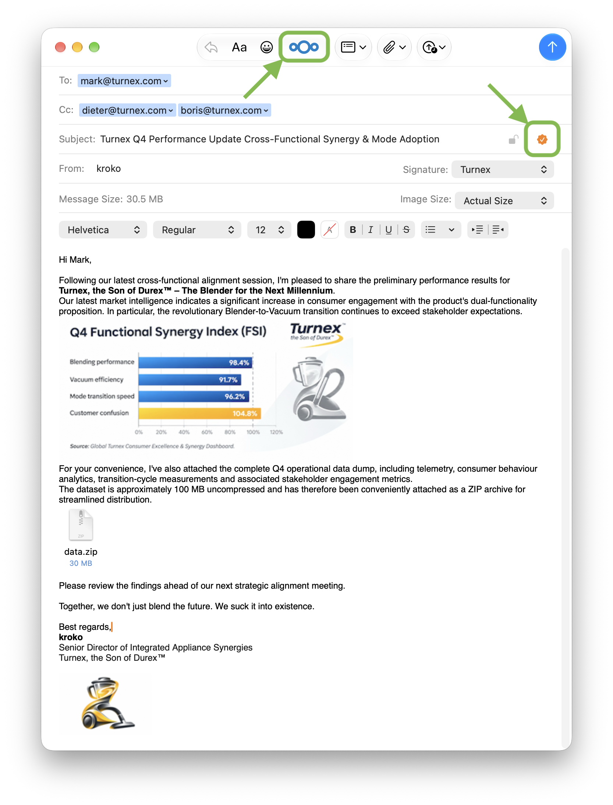
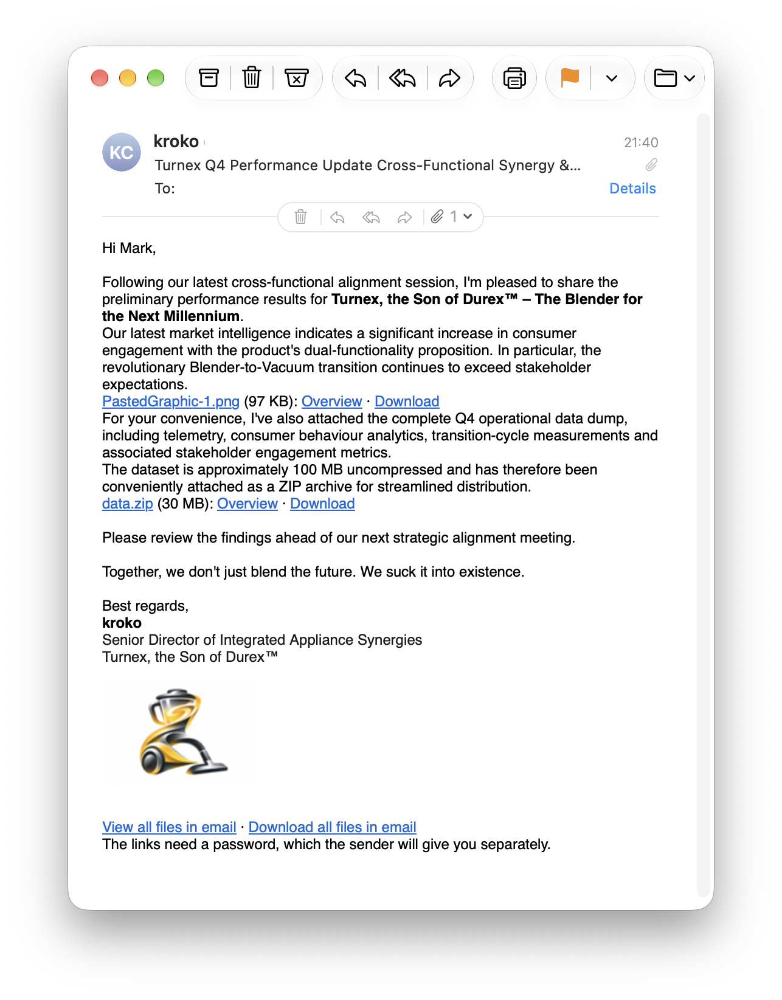
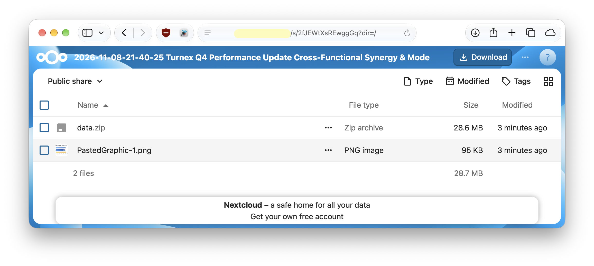
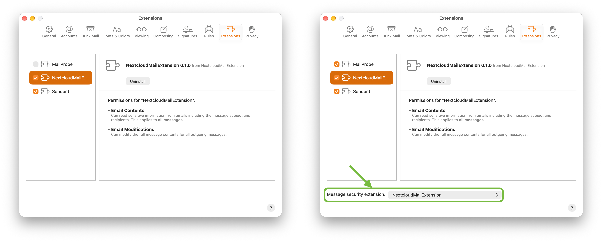
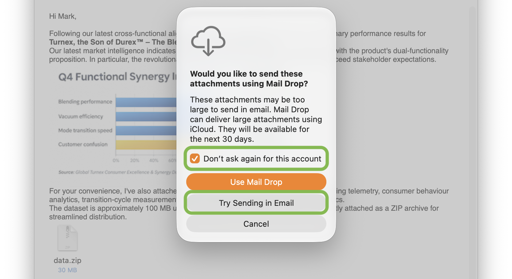
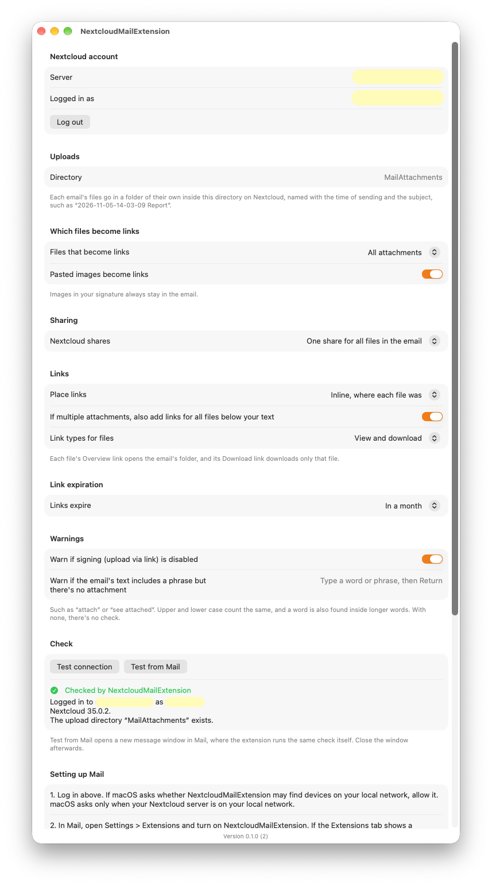

# Nextcloud Mail Extension (for Apple Mail)

NextcloudMailExtension is an extension for Apple Mail on macOS. When you send an email, its attachments are uploaded to your Nextcloud server and replaced in the email by share links. Recipients download the files from your server, and your email stays small — no more bounces for oversized mail, no more dependence on Apple's Mail Drop or a provider's attachment limit.

## Index

- [How it works](#how-it-works)
- [Requirements](#requirements)
- [Installing](#installing)
- [What you can control](#what-you-can-control)
  - [In the app's settings](#in-the-apps-settings)
  - [Per email, from the extension's toolbar button in Mail](#per-email-from-the-extensions-toolbar-button-in-mail)
- [Good to know](#good-to-know)
- [Privacy](#privacy)
- [Why Sign is used](#why-sign-is-used)

## How it works

Attach files to an email in Mail as usual, make sure **Sign** is on, and hit Send. The extension uploads each file to a subfolder for that email in your Nextcloud, and puts links in their place:

- Each file gets a **view** link and a **download** link — or just a download link, if you prefer. With the default, one share for the whole email, the view link is called **Overview** and opens the email's folder, which lists all its files. With a separate share for each file, it's called **View** and opens that file's own page.
- With two or more files, the email can also get **View all files in email**, which opens the email's folder, and **Download all files in email**, which downloads all its files as one zip.
- Nothing is ever sent half-way: if an upload fails, the email is not sent, and you keep your files in the message window. Mail shows what went wrong, and how to send the email with its files attached instead.

## Requirements

- A Mac with Apple silicon, running macOS 27 or later.
- A Nextcloud server, version 34 or later, reachable over HTTPS.
- You log in to Nextcloud through its own login page in your browser; the extension never sees or stores your Nextcloud password, and connects with an app password instead.
- **Sign** switched on in Mail's message window. Mail hands the outgoing email to the extension only while Sign is on.
- No signing or encryption with certificates: while NextcloudMailExtension is chosen for message security, Mail can't sign or encrypt email with them.

## Installing

1. [Download](_placeholder-link-to-latest-release-dmg_) prebuilt App (signed and notarized) from releases.
2. Drag the app into an Applications folder: `/Applications` for every user of the Mac, or `~/Applications` (the Applications folder in your home folder) for you only. Keep only that one copy, and delete any other, such as one left in Downloads, since macOS may use it instead. Start the app once, to log in to your Nextcloud server and set your preferences. If macOS asks whether NextcloudMailExtension may find devices on your local network, allow it. macOS asks only when your Nextcloud server is on your local network.
3. In Mail, open **Settings → Extensions** and enable **NextcloudMailExtension**.
4. If Mail shows a **"Message security extension"** popup, choose NextcloudMailExtension there. (The extension takes over the Sign button in the message window: with Sign on, Mail hands the outgoing message to the extension, which is what makes the upload possible.)
5. Restart Mail.
6. Open a new message and click the extension's toolbar button, the one with Nextcloud's logo. If macOS asks whether "NextcloudMailEx" may find devices on your local network, allow it too. That's the extension in Mail, which needs a permission of its own, listed in System Settings as NextcloudMailExtensionPlugIn.
7. Turn on **Sign**, the badge button at the right of the subject line. Files become links only while it's on, and it stays on for later messages.

When an email is over your email provider's size limit, Mail asks about **Mail Drop** before the extension gets its turn. Choose **Try Sending in Email**, and tick **Don't ask again for this account**. The files then travel via your Nextcloud, not via Mail Drop, and the email stays small. If you choose **Use Mail Drop** instead, the email goes out with Mail Drop's link, and the files already uploaded for it are deleted from Nextcloud.

## What you can control

### In the app's settings

- **Server and folder** — where the files go. Each email gets its own subfolder within the folder you choose, "MailAttachments" by default, so files of different emails never clash, and all of one email's files stay together.
- **Which files become links** — every attachment (the default), or only files over a size limit in MB, so that small files still arrive attached.
- **Size limit applies to** — each file individually (the default), or all files of the email together.
- **Pasted images become links** — whether images pasted into the email body follow the same rule (on by default). Images in your signature always stay in the email.
- **Link expiry** — links expire after a week, a month (default) or a year, any custom period you type, or never. If your server caps expiry, the date shown in the email is the one the server actually set.
- **Nextcloud shares** — one share for the whole email's folder (the default), or a separate share for each file. Nextcloud lets each user create only 20 new shares in 10 minutes by default, and a separate share for each file uses that up faster, so the settings warn you about it and link to how an admin raises the limit.
- **Place links** — each file's links right where the file was dropped in the text (the default), or a tidy list of name, size and links below your message.
- **Link types** — view and download links per file (the default), or download only.
- **Links for all files** — add "View all files in email" and "Download all files in email" links below your text when two or more files became links. Off by default; with the links placed below your text, they're always added.
- **Warn if signing is disabled** — if Sign is off and files would have become links, Mail asks before sending them attached, instead of silently sending a large email (on by default).
- **Forgotten attachment check** — words or phrases you list (say, "attachment" or "see attached") trigger an alert when your email text mentions one but no file is in the message. Only your own text is checked; quotes, subject and signature are ignored. With no words listed, there's no check.

### Per email, from the extension's toolbar button in Mail

- Choose for this email: **use the settings**, send **all files via Nextcloud** (pasted images included), or keep **all files as attachments**, so that nothing uploads. If you keep the files after an Undo Send, what the first send uploaded is deleted.
- Set an **expiry** for just this email's links.
- Set a **password** for just this email's links. The password never goes into the email; tell your recipients some other way. A moment after you stop typing, the popover checks the password against your server's password policy and shows why it's refused, and it can generate a password the policy accepts, and copy it for you.

## Good to know

- While a slow upload runs, NextcloudMailExtension shows a notification, and another when it's done. Allow its notifications when macOS asks, or in **System Settings → Notifications**.
- Send Later uploads the files when you schedule the email, so the links' expiry starts then.
- Your Sent mailbox keeps the links, not the files, so once a link expires, the file is only on Nextcloud.

## Privacy

No telemetry. Files go only to the server you configured; message contents, addresses and passwords are never logged; credentials live only in the macOS Keychain.

## Why Sign is used

You might ask why Sign is used. Well, as of now that is the only way an Apple Mail extension can officially alter message data on send. For a technical intro, see the project's [README](https://github.com/WARP-LAB/nextcloud-mail-extension#readme), which has a rant on history and this extension. Anyway, you're welcome.
